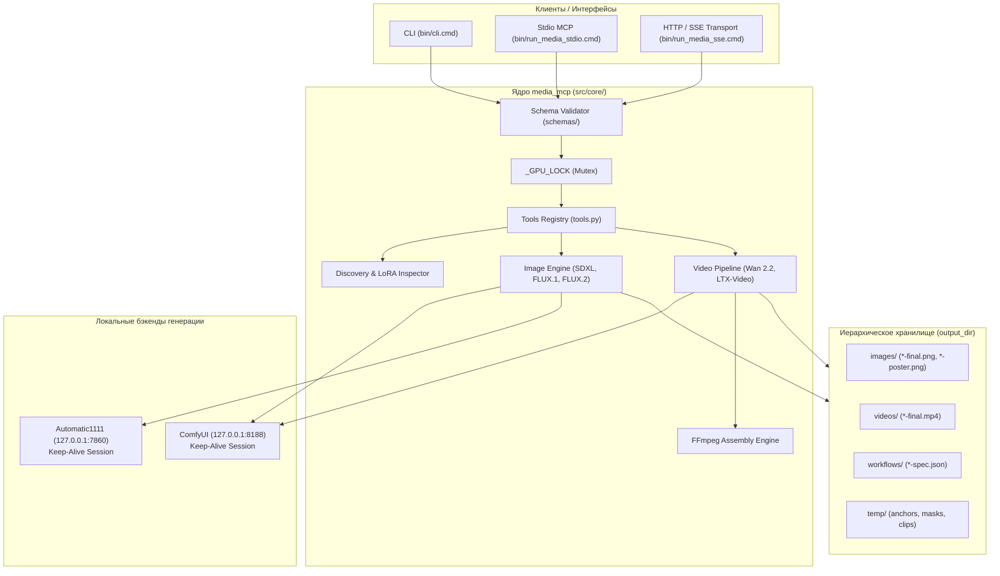

# Архитектура media_mcp (Unified Media MCP Server)

Документ описывает общую архитектуру сервера `media_mcp`, принципы проектирования, контракты взаимодействия, организацию схем данных и обоснование ключевых инженерных решений.

---

## 1. Концепция и цели объединения

Сервер `media_mcp` объединяет генерацию изображений (через Automatic1111 и ComfyUI) и сценарный видеопайплайн (на базе Wan 2.2 и LTX-Video) в единую, строгую систему:
1. **Единая инфраструктура:** общие клиенты A1111/ComfyUI с пулингом соединений, инспектор `.safetensors`, логика путей и строгая валидация JSON Schema.
2. **Исключение коллизий ресурсов (VRAM Contention):** межпоточный мьютекс `_GPU_LOCK` гарантирует последовательное выполнение тяжёлых генераций в A1111 и ComfyUI, предотвращая `CUDA Out of Memory`.
3. **Единый набор инструментов для LLM-агентов:** 9 канонических инструментов с инвариантными контрактами входа и выхода.



---

## 2. Принцип независимости от транспорта (Transport Independence)

Сервер `media_mcp` строго разделяет протокол доставки сообщений и бизнес-логику:
- **CLI (`bin/cli.cmd` / `src/cli.py`):** предназначен для ручного тестирования, скриптов автоматизации и пакетной обработки. Поддерживает передачу параметров через `--payload <path.json>`, `--stdin`, инлайн `--<key> <val>` и генерацию терминальной справки (`bin/cli.cmd image_generate --help`).
- **Stdio MCP (`bin/run_media_stdio.cmd` / `src/mcp/media_mcp.py`):** стандартный транспорт для интеграции с AI-ассистентами (Antigravity, Cursor, Claude Desktop) по протоколу Model Context Protocol.
- **SSE Transport (`bin/run_media_sse.cmd` / `src/mcp/media_mcp.py --sse`):** HTTP Server-Sent Events транспорт для сетевых сценариев (Open-WebUI) и прямого стриминга медиа-файлов по HTTP Range запросам (`/images/`, `/videos/`).

**Ключевое правило:** Все транспорты вызывают единую точку входа `execute_tool(tool_name, payload, progress_callback)` в `src/core/tools.py`.

---

## 3. Строгая изоляция и нулевой хардкод (Zero Hardcoding)

Репозиторий `media_mcp` спроектирован так, чтобы код был полностью отчуждаем от конкретной операционной системы, путей диска пользователя и сетевых адресов:
1. **Запрет путей по умолчанию:** в коде отсутствуют литералы путей в качестве неявных значений по умолчанию.
2. **Обязательная конфигурация:** любой запуск требует явного указания конфигурационного файла:
   - Через аргумент командной строки: `--config <path_to_config.json>`.
   - Через переменную окружения: `MEDIA_CONFIG=<path_to_config.json>`.
   - Если конфигурация не найдена, сервер не пытается угадывать пути в текущей рабочей папке (CWD), а немедленно возвращает ошибку конфигурации.
3. **Иерархическая структура каталогов:** конфигурация определяет корневую папку вывода `output_dir` и папку `comfy_dir`. Все остальные подкаталоги выводятся автоматически:
   - `output_dir` $\to$ `images/`, `videos/`, `workflows/`, `temp/`.
   - `comfy_dir` $\to$ `input/`, `output/`.
4. **POSIX-нормализация путей:** во всех возвращаемых JSON-ответах и файлах спецификаций пути приводятся к стандарту POSIX через `Path(...).resolve().as_posix()`.

---

## 4. Схемоцентричная архитектура (Schema-First Contract)

Все входные и выходные данные сервера валидируются против JSON Schema стандарта **Draft 2020-12**:

```
schemas/
├── config.json                     # Валидация конфигурации media_mcp
├── scenario.json                   # Каноническая схема видеосценария и $defs
├── requests/                       # Контракты входных параметров инструментов
│   ├── image_generate.json
│   ├── video_generate.json
│   ├── video_validate.json
│   ├── media_get_models.json
│   ├── media_get_samplers.json
│   ├── media_get_loras.json
│   ├── media_get_status.json
│   ├── media_interrupt.json
│   └── media_reload_modules.json
└── responses/                      # Контракты выходных структур инструментов
    ├── image_generate.json
    ├── video_generate.json
    ├── video_validate.json
    ├── media_get_models.json
    ├── media_get_samplers.json
    ├── media_get_loras.json
    ├── media_get_status.json
    ├── media_interrupt.json
    └── media_reload_modules.json
```

### Динамическая справка CLI из схем (`--help`)
Утилита CLI не содержит захардкоженных текстов описания параметров. При вызове:
```bash
bin/cli.cmd <tool_name> --help
```
модуль `src/core/schema_formatter.py` на лету считывает соответствующую JSON-схему из `schemas/requests/<tool_name>.json` и `schemas/responses/<tool_name>.json`, форматирует таблицу аргументов и примеров из `examples/` и выводит её в терминал.

---

## 5. Контракт структурированного вывода (Zero Base64 Payload)

Инструменты возвращают **только строгие структурированные метаданные и абсолютные POSIX-пути к файлам на диске**:
- `image_path`: путь к чистовому сгенерированному изображению.
- `video_path`: путь к смонтированному видеоролику.
- `poster_path`: путь к чистовому постеру (опорному кадру сцены 1).
- `spec_path`: путь к сохранённому файлу воспроизводимой JSON-спецификации.

---

## 6. Каталог инструментов ядра

| Инструмент | Назначение | Ключевые параметры | Особенности |
| :--- | :--- | :--- | :--- |
| `image_generate` | Синтез изображений (txt2img, img2img, inpaint, outpaint). | `engine` (`sdxl`, `flux1`, `flux2`), `model`, `prompt`, `image_path`, `mask_path`, `fit` (`crop`, `outpaint`), `loras`. | Генерация в оптимальном ~1.0 MP (`native_width` x `native_height`) + Lanczos post-resize + `warnings`. |
| `video_generate` | Рендеринг сценарных видеороликов. | `video` (`engine`: `wan-fast`, `wan-full`, `ltx`; `model`), `image`, `scenes`. | 5D латентное префиксное кондиционирование, 1-frame I2V, FFmpeg `-c copy`. |
| `video_validate` | Сухая валидация сценария перед запуском. | Входные параметры аналогичны `video_generate`. | Проверяет схему, тайминги (лимиты окон диффузии движков) и пропорции кадров без запуска GPU. |
| `media_get_models` | Инспекция доступных чекпоинтов и бандлов. | `engine` (опционально), `type` (`image` или `video`, опционально). | Инвариантная структура `{"image": {...}, "video": {...}}` с группировкой бандлов Wan 2.2. |
| `media_get_samplers`| Получение поддерживаемых сэмплеров. | `engine`, `model` (обязательны). | Возвращает список `samplers`, где индекс `[0]` — рекомендуемый по умолчанию. |
| `media_get_loras` | Каталог совместимых LoRA с триггерами. | `engine`, `model` (обязательны), `pattern` (опционально). | Фильтрует LoRA по архитектуре `.safetensors` и regex-шаблону по имени и триггерам. |
| `media_get_status` | Мониторинг бэкендов и очередей. | Без параметров. | Статус `_GPU_LOCK`, состояние очередей ComfyUI/A1111 и фаза видеопайплайна. |
| `media_interrupt` | Прерывание текущей генерации. | Без параметров. | Посылает сигнал отмены в ComfyUI, A1111 и активный видеопайплайн. |
| `media_reload_modules`| Горячая перезагрузка кода ядра. | Без параметров. | Выполняет `importlib.reload` для модулей ядра в топологическом порядке с сохранением `_GPU_LOCK`. |
