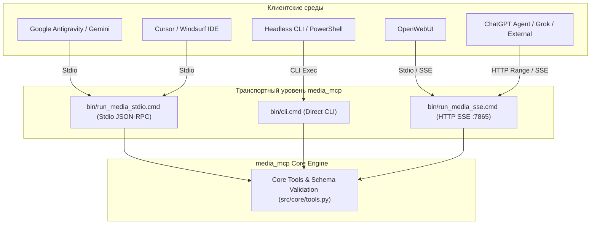

# Интеграция с клиентами и философия разработки (Client Integration & Philosophy)

Документ описывает принципы интеграции сервера `media_mcp` с внешними AI-клиентами (Antigravity, Cursor, OpenWebUI, ChatGPT), конфигурацию окружения, инструменты отладки и базовую инженерную философию проекта.

---

## 1. Мульти-клиентская архитектура (Multi-Client MCP)

Репозиторий `media_mcp` спроектирован как универсальный шлюз к локальному GPU-кластеру (ComfyUI и A1111) для работы с разнородными AI-клиентами:



---

## 2. Подключение к AI-ассистентам

### А. Подключение по Stdio MCP (Antigravity, Cursor, Claude Desktop)
В конфигурационный файл MCP клиента (`mcp_config.json` / `settings.json`) добавляется секция:

```json
{
  "mcpServers": {
    "media_mcp": {
      "command": "G:/Git/media_mcp/bin/run_media_stdio.cmd",
      "args": ["--config", "G:/Git/Gemini/media_mcp/config.json"]
    }
  }
}
```

### Б. Прямой запуск из скриптов и терминала (CLI)
Любой инструмент может быть запущен напрямую без запуска MCP-сервера через `bin/cli.cmd` (или `bin/cli.sh`):
```bash
# Получение статуса кластера
bin/cli.cmd --config path/to/config.json media_get_status

# Интроспекция параметров инструмента
bin/cli.cmd image_generate --help

# Генерация картинки по JSON-файлу спецификации
bin/cli.cmd --config path/to/config.json image_generate --payload examples/mcp_image_generate.json

# Конвейерная передача JSON через stdin
cat examples/scenario.json | bin/cli.cmd --config path/to/config.json video_generate --stdin
```

---

## 3. Инструменты горячей разработки ядра

### А. Горячая перезагрузка модулей (`media_reload_modules`):
При разработке и отладке конвейеров нет необходимости перезапускать MCP-сервер:
1. Инструмент `media_reload_modules` выполняет `importlib.reload()` для всех загруженных модулей ядра `src/core/`.
2. Перезагрузка выполняется в строгом **прямом топологическом порядке зависимостей** (от `core.config` и `core.schema_validator` к генераторам, пайплайнам и `core.tools`), с немедленным восстановлением активной конфигурации и сохранением экземпляра мьютекса `_GPU_LOCK`.

### Б. Мониторинг состояния кластера (`media_get_status`):
Возвращает полную картину здоровья локальной инфраструктуры:
- Статус блокировки видеопамяти `_GPU_LOCK` (`BUSY` / `IDLE`).
- Доступность и текущую модель в Automatic1111 (`a1111_available`).
- Состояние очередей ComfyUI (`comfy_online`).
- Активную фазу сценарного видеопайплайна (`pipeline`).

---

## 4. Инженерная философия: Принцип Zero Legacy

> **Ключевой регламент проекта:**
> Репозиторий `media_mcp` является современным, чистым проектом. В нём **категорически запрещено** поддерживать устаревший легаси-код, переходные прослойки и дублирующие методы.

1. **Никаких переходных прослоек:** При обновлении контрактов старые поля и неиспользуемые ветки кода немедленно удаляются.
2. **Единый канонический путь:** Каждая задача решается одним строго типизированным способом, зафиксированным в `schemas/`.
3. **Чистота зависимостей:** Ядро работает поверх стандартной библиотеки Python и четырёх легковесных пакетов (`jsonschema`, `requests`, `urllib3`, `Pillow`) без необходимости импорта тяжёлого `torch` или `numpy` в процессе MCP-сервера.
