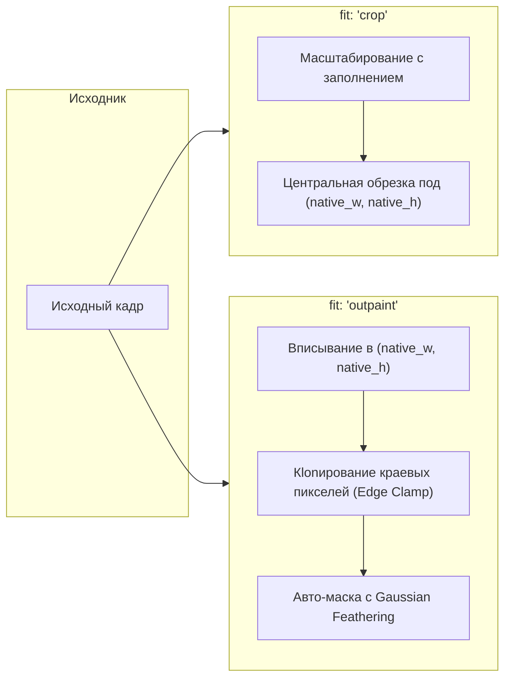

# Конвейер генерации изображений (Image Pipeline)

Документ подробно описывает принципы работы генератора изображений в `media_mcp`, унификацию режимов (`txt2img`, `img2img`, `inpaint`, `outpaint`), единый алгоритм расчёта оптимального нативного разрешения (~1.0 MP) с последующим масштабированием, работу с непрерывными масками и семантику Guidance / CFG.

---

## 1. Единый интерфейс генерации (`image_generate`)

Все операции синтеза и редактирования изображений выполняются через единый инструмент `image_generate` (при наличии `image_path` и `fit: 'crop'` параметр `prompt` опционален для пассивной адаптации):

| Режим | Необходимые параметры в запросе | Поведение пайплайна |
| :--- | :--- | :--- |
| **Txt2Img** | `engine`, `model`, `prompt` | Генерация изображения из шума по текстовому описанию. |
| **Img2Img** | `engine`, `model`, `prompt`, `image_path`, `denoise` | Трансформация исходного изображения с сохранением композиции. |
| **Inpainting** | `engine`, `model`, `prompt`, `image_path`, `mask_path`, `denoise` | Локальная регенерация области, отмеченной полутоновой маской. |
| **Outpainting** | `engine`, `model`, `prompt`, `image_path`, `fit: "outpaint"`, `width`, `height` | Дорисовывание недостающих полей холста с автогенерацией маски и Gaussian feathering. |
| **Passive Crop** | `image_path`, `width`, `height`, `fit: "crop"` | Пассивная подгонка разрешения и кадрирование без запуска нейросетевой диффузии (когда `prompt` и `mask_path` не указаны). |

---

## 2. Единый закон оптимального разрешения (~1.0 MP) и Post-Resize

Диффузионные архитектуры (SDXL, Pony, FLUX.1, FLUX.2) обучались на бюджете пикселей около **1 мегапикселя** ($S_{\text{opt}} = 1024 \times 1024 = 1\,048\,576$ пикселей). Прямая генерация в меньшем разрешении (например, $832 \times 480 \approx 0.4\text{ MP}$) приводит к деградации мелких деталей лиц и глаз в UNet/DiT, а прямая генерация в слишком высоком разрешении — к дублированию конечностей и нарушению композиции.

Поэтому в `src/core/image_engine.py` действует **единый двухэтапный конвейер для всех движков (`sdxl`, `flux1`, `flux2`) и всех режимов (`txt2img`, `img2img`, `inpaint`, `outpaint`)**:

1. **Расчёт нативного разрешения диффузии `(native_width, native_height)`:**
   Для целевого соотношения сторон $AR = W_{\text{target}} / H_{\text{target}}$ вычисляются оптимальные габариты с площадью $\approx 1\,048\,576$ пикселей:
   $$W_{\text{raw}} = \sqrt{1048576 \times AR}, \quad H_{\text{raw}} = \sqrt{\frac{1048576}{AR}}$$
   Полученные значения квантуются с шагом архитектуры `quant_step`:
   - Для **`sdxl`**: шаг квантования **`64px`** (`snap_to_64`) для идеального выравнивания уровней пирамиды сверток UNet.
   - Для **`flux1`** и **`flux2`**: шаг квантования **`16px`** (`snap_to_16`) для патчей DiT ($8\times$ VAE $\times 2\times$ patch).
2. **Генерация и финальное масштабирование (Lanczos Post-Resize):**
   - Диффузия (и подготовка входного холста/маски в `img2img`/`inpaint`/`outpaint`) всегда выполняется в оптимальном разрешении `(native_width, native_height)`.
   - Если целевой размер `(width, height)` отличается от `(native_width, native_height)`, готовое изображение масштабируется фильтром `Image.Resampling.LANCZOS` точно к `(width, height)`.
   - В ответе `image_generate` всегда возвращаются как итоговые `width`, `height`, так и фактические размеры диффузии `native_width`, `native_height`.
3. **Нефатальные предупреждения (`warnings`):**
   - Если запрошенная площадь превышает $1.1\text{ MP}$ ($W \times H > 1\,100\,000$, т.е. выполняется апскейл выше нативного разрешения модели) или соотношение сторон выходит за пределы $2.4:1$ ($AR > 2.4$ или $AR < 1/2.4$), генерация успешно выполняется, а в ответе возвращается список `warnings` с подробным пояснением.

---

## 3. Режимы подгонки холста (`fit: "crop"` vs `fit: "outpaint"`)

Когда при передаче `image_path` явно указаны `width` и `height`:

1. **Режим `crop` (Центральная обрезка):**
   Исходное изображение (и пользовательская маска, если передана) пропорционально масштабируется с заполнением холста `(native_width, native_height)` и центрированно кадрируется.
2. **Режим `outpaint` (Дорисовывание полей):**
   Исходное изображение масштабируется с полным вписыванием внутрь `(native_width, native_height)`. Пустые поля заполняются краевыми пикселями исходника (edge clamping на чистом `PIL.Image` без `numpy`), и автоматически строится полутоновая маска инпейнтинга с плавным гауссовым размытием границы (`GaussianBlur(radius=4)`).

---

## 4. Контракт непрерывных полутоновых масок (Continuous Gradients)

1. Маски обрабатываются как непрерывные одноканальные полутоновые карты (`PIL` mode `L`, значения $0 \dots 255$, нормализованные в $[0.0, 1.0]$ без жёсткой бинаризации).
2. **Семантика градиента:**
   - $0.0$ (чёрный) — полное сохранение оригинального пикселя.
   - $1.0$ (белый) — полная регенерация области диффузией.
   - $0.1 \dots 0.9$ (серые оттенки) — плавное масштабирование силы вмешательства.

---

## 5. Семантика Guidance vs CFG

| Архитектура / Движок | Параметр в запросе | Внутренняя реализация | Типичные значения |
| :--- | :--- | :--- | :---: |
| **`sdxl` (A1111)** | `cfg` | `cfg_scale` в WebUI API (двойной прогон UNet: cond + uncond) | $5.0 \dots 7.0$ (дефолт: $5.5$) |
| **`flux1` / `flux2` (ComfyUI)** | `guidance` | Нода `FluxGuidance` (Guidance-distilled вектор в DiT) | $3.0 \dots 4.0$ (дефолт: $3.5$) |
| **`wan-fast` (ComfyUI)** | `cfg` | 4-шаговая дистилляция LightX2V | $1.0$ (дефолт: $1.0$) |
| **`wan-full` / `ltx` (ComfyUI)** | `cfg` | Классический CFG + Temporal CFG Ramp-Up в `WanLatentPrefixLock` | $3.0 \dots 4.0$ (дефолт: $3.5$) |
