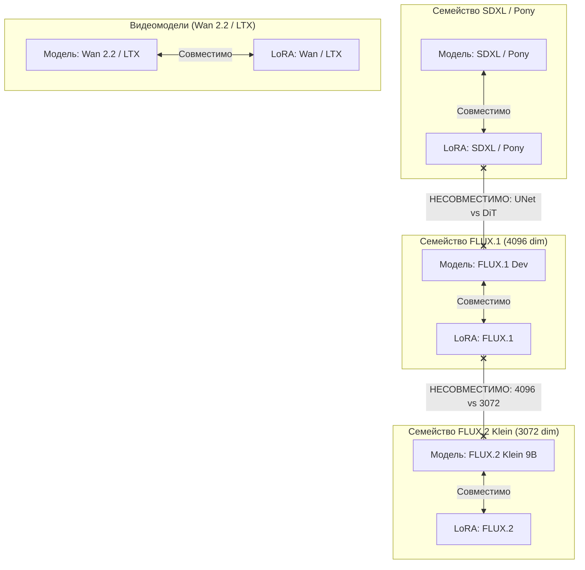

# Движки генерации, модели и LoRA (Models, Engines & LoRA Guide)

Документ содержит подробный обзор поддерживаемых нейросетевых архитектур (`sdxl`, `flux1`, `flux2`, `wan-fast`, `wan-full`, `ltx`), автоматической классификации по заголовкам `.safetensors`, бандлов Wan 2.2 и правил совместимости LoRA.

---

## 1. Сравнительный анализ поддерживаемых движков

В `media_mcp` интегрированы два семейства бэкендов: **Automatic1111 WebUI** (для моделей SD 1.5, SDXL, Pony) и **ComfyUI** (для Flow Matching DiT: FLUX.1, FLUX.2, Wan 2.2 и LTX-Video). Во всех запросах параметры `engine` и `model` являются **строго обязательными**.

| Движок (`engine`) | Бэкенд | Архитектура нейросети | Шаги / Сэмплер | Guidance / CFG | Назначение и сильные стороны |
| :--- | :---: | :--- | :---: | :---: | :--- |
| **`sdxl`** | A1111 | UNet + dual CLIP (OpenCLIP + CLIP ViT-L) | 20–30 шагов Euler a / DPM++ 2M Karras | `cfg = 5.0–7.0` (дефолт: `5.5`) | Максимальная верность персонажным LoRA (Pony, Illustrious, SDXL), точный контроль анатомии и костюмов. |
| **`flux1`** | ComfyUI | 12B Rectified Flow Matching DiT (4096 dim) | 20–30 шагов euler | `guidance = 3.5` (Distilled) | Фотореализм кожи, сложная многообъектная композиция, точный рендеринг текста. |
| **`flux2`** | ComfyUI | 9B Flow Matching DiT (FLUX.2 Klein, 3072 dim) | 20–28 шагов euler | `guidance = 3.5` | Высокая скорость, нецензурированные модели семейства FLUX.2 Klein (9B), поддержка специализированных FLUX.2 LoRA. |
| **`wan-fast`** | ComfyUI | 14B Spatiotemporal Dual-Expert DiT + LightX2V 4-Step LoRA | 4 шага (2+2) euler | `cfg = 1.0` | **Продакшн-движок видео по умолчанию.** Ультра-быстрый рендеринг с двухфазным переключением экспертов (`high_noise` $\to$ `low_noise`). |
| **`wan-full`** | ComfyUI | 14B Spatiotemporal Dual-Expert DiT (Full Steps) | 20–30 шагов (10+10) euler | `cfg = 3.5` + Temporal Ramp | Референсный кинематографический видеорендеринг максимальной детализации без ускоряющих дистилляционных LoRA. |
| **`ltx`** | ComfyUI | LTX-Video DiT | 20–30 шагов euler | `cfg = 3.0–3.5` | Видеомодель с $8\times$ временным сжатием VAE (128 латентных каналов) и 5D префиксным чейнингом. |

---

## 2. Автоматическая классификация моделей и бандлы Wan 2.2 (`discovery.py`)

### Бинарная инспекция `.safetensors` (`<0.5ms` на файл):
Вместо ненадёжного угадывания архитектуры только по подстрокам в имени файла, модуль `src/core/lora_inspector.py` (`read_safetensors_header` и `detect_checkpoint_engine`) читает JSON-заголовок `.safetensors` и анализирует ключи и размерности тензоров:
- Наличие `double_blocks.0.img_attn.qkv.weight` с размерностью `3072` однозначно идентифицирует **`flux2`** (FLUX.2 Klein 9B), а с размерностью `4096` — **`flux1`** (FLUX.1 Dev 12B).
- Наличие `patch_embedding.weight` (5D conv) идентифицирует семейство **Wan 2.2** (`wan`).
- Наличие `scale_shift_table` / `adaln_single` идентифицирует **`ltx`**.
- Наличие `conditioner.embedders.1` идентифицирует **`sdxl`**.

### Группировка парных моделей Wan 2.2 (`high_noise` + `low_noise`):
Архитектура Wan 2.2 I2V использует два раздельных эксперта: `high_noise` (первая половина шагов) и `low_noise` (вторая половина шагов).
- Инструмент `media_get_models` автоматически находит парные файлы на диске (например, `wan2.2_i2v_high_noise_14B_fp8_scaled.safetensors` и `wan2.2_i2v_low_noise_14B_fp8_scaled.safetensors`) и возвращает их как **единый канонический идентификатор бандла**:
  `wan2.2_i2v_14B_fp8_scaled.safetensors` (только если оба файла реально присутствуют на диске).
- При запуске `video_generate` функция `discovery.resolve_wan_model_bundle(model)` автоматически разрешает каноническое имя бандла обратно в пару `(high_file, low_file)` для нод `UNETLoader`.

---

## 3. Архитектурная совместимость и инспекция LoRA (`media_get_loras`)

### Главное правило проекта:
> **Активный чекпоинт/модель является первичным.** Категорически запрещено переключать базовую модель ради того, чтобы «подогнать» её под желаемую LoRA. LoRA выбирается строго под архитектуру текущей модели.

### Извлечение триггерных слов для A1111 и ComfyUI:
Инспектор `inspect_lora_file` извлекает триггерные слова для всех движков (`sdxl`, `flux1`, `flux2`, `wan-fast`, `wan-full`, `ltx`) из двух источников:
1. Метаданные `__metadata__` внутри `.safetensors` (`ss_tag_frequency`, `modelspec.trigger_phrase`, `trigger_words`, `activation_text`).
2. Соседние sidecar-файлы в каталоге `loras/` (`<stem>.json`, `<stem>.civitai.info`, `<name>.civitai.info` — поля `trainedWords`, `activation text`, `triggerWords`).

### Поиск по регулярному выражению (`pattern` в `media_get_loras`):
Параметр `pattern` (регистронезависимый Python regex) сопоставляется одновременно с именем LoRA и со списком всех её триггерных слов.
