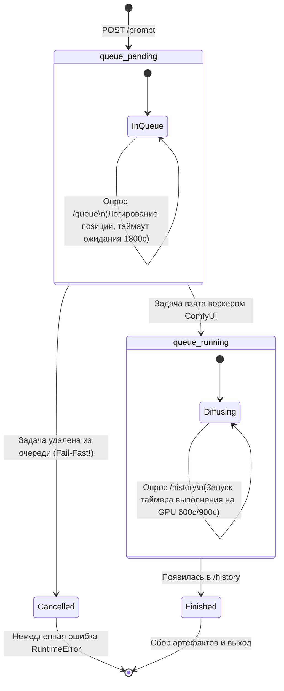

# Сетевое взаимодействие, очереди и управление GPU (Network & Queue Architecture)

Документ описывает сетевую архитектуру взаимодействия с бэкендами (ComfyUI и Automatic1111), решение проблемы `TIME_WAIT` socket churn на Windows, активный трекинг очереди ComfyUI, GPU-сериализацию и жизненный цикл прерываний.

---

## 1. HTTP Keep-Alive и пулинг соединений

### Проблема одноразовых соединений (`urllib.request.urlopen`)
В стандартной библиотеке Python `urllib` каждый вызов функции `urlopen()` инициирует новое TCP-соединение:
1. Выполняется 3-этапное рукопожатие (`SYN` $\to$ `SYN-ACK` $\to$ `ACK`).
2. Передаются данные запроса и считывается ответ.
3. Соединение закрывается (`FIN` $\to$ `ACK`).

В операционной системе Windows закрытый сокет переходит в состояние **`TIME_WAIT`** на 120 секунд (TCP 2MSL).
При активном опросе статуса очереди ComfyUI (`/queue`) и истории выполнения (`/history`) с интервалом 0.5–1.0 секунды за 2 минуты накапливаются сотни сокетов в состоянии `TIME_WAIT`.

#### Последствия:
- **Исчерпание эфемерных портов:** ОС Windows блокирует открытие новых сетевых сокетов к `127.0.0.1`.
- **Сбои доступа:** Клиент падает с системной ошибкой:
  ```text
  [WinError 10013] An attempt was made to access a socket in a way forbidden by its access permissions
  ```
- **Случайные задержки (Лаги):** Запросы подвисают на 2–5 секунд перед установлением соединения.

---

### Архитектурное решение: `requests.Session` с HTTPAdapter

Модули `src/core/comfy_client.py` и `src/core/a1111_client.py` переведены на постоянные сессии с пулом соединений:

```python
session = requests.Session()
session.trust_env = False  # КРИТИЧНО для Windows localhost!

adapter = HTTPAdapter(
    pool_connections=5,
    pool_maxsize=10,
    max_retries=Retry(total=1, backoff_factor=0.2)
)
session.mount("http://", adapter)
session.mount("https://", adapter)
```

### Зачем нужен `trust_env = False`:
По умолчанию библиотека `requests` считывает системные переменные окружения (`HTTP_PROXY`, `HTTPS_PROXY`, `ALL_PROXY`, системные прокси Windows).
В изолированных средах или корпоративных сетях запросы к локальному адресу `127.0.0.1` начинают перенаправляться через внешний прокси, что вызывает ошибку `ProxyError` или многосекундную задержку. Установка `session.trust_env = False` гарантирует прямое, мгновенное обращение к локальному сокету без участия системных прокси.

### Градация таймаутов:
- **Инспекция и быстрый статус (`/system_stats`, `/sdapi/v1/sd-models`):** 3–10 секунд.
- **Переключение модели (`/sdapi/v1/options`):** 120 секунд (загрузка чекпоинта 7–20 ГБ с NVMe в VRAM).
- **Ожидание диффузии (`/history`):** 600–900 секунд.

---

## 2. Активный трекинг очереди ComfyUI (`wait_for_prompt`)

### Дефект наивного опроса `/history`:
В ComfyUI постановка задачи в очередь (`POST /prompt`) возвращает идентификатор `prompt_id`. Если перед нашей задачей в очереди уже стоит другой долгий рендеринг (например, 10-секундный видеоролик Wan 2.2, длящийся 3 минуты), новая задача встаёт в `queue_pending`.
Если клиент запускает фиксированный таймаут генерации (например, 600с) сразу после вызова `/prompt`, драгоценное время диффузии сгорает, пока задача просто ожидает своей очереди на GPU.

### Трёхфазный жизненный цикл задачи:



1. **Фаза 1: `queue_pending` (Ожидание в очереди):**
   - Задача находится в списке ожидающих.
   - Клиент отслеживает её номер в очереди (`queue_pos`) и логирует статус.
   - Время нахождения в `queue_pending` **не вычитается** из таймаута GPU-диффузии. Для очереди действует отдельный щедрый лимит `max_queue_wait = 1800s`.
2. **Фаза 2: `queue_running` (Активная диффузия на GPU):**
   - В момент, когда `prompt_id` переходит в `queue_running`, ComfyUI начинает реальное исполнение графа нод.
   - Только с этой миллисекунды запускается основной рабочий таймаут (`timeout = 600s/900s`).
3. **Фаза 3: Быстрый отказ (Fail-Fast on Drop):**
   - Если `prompt_id` исчез из `queue_pending`, но не появился в `queue_running` и отсутствует в `/history`, это означает, что пользователь или сервер сбросил очередь ComfyUI.
   - Клиент не ждёт 600 секунд впустую, а мгновенно выбрасывает `RuntimeError("ComfyUI prompt <id> was cancelled or dropped from the queue")`.

---

## 3. GPU-сериализация (`_GPU_LOCK`)

### Проблема разделения видеопамяти:
ComfyUI и Automatic1111 функционируют параллельно на одной физической видеокарте (например, RTX 4090 24GB).
Генерация видео Wan 2.2 (14B) занимает 18–22 ГБ VRAM. Генерация изображения FLUX.1 Dev занимает 16–20 ГБ VRAM.
Если во время фоновой сборки видео прилетит параллельный запрос на генерацию картинки (или наоборот), произойдёт аллокация второй тяжёлой модели в память, что гарантированно приведёт к аварийному завершению процесса с ошибкой `CUDA: out of memory`.

### Реализация:
В модуле `src/core/tools.py` объявлен глобальный мьютекс процесса:
```python
_GPU_LOCK = threading.Lock()
```
Функции `execute_image_generate` и `execute_video_generate` выполняются строго под защитой этого мьютекса:
```python
def execute_image_generate(args, ...):
    with _GPU_LOCK:
        # Эксклюзивный доступ к GPU
        ...
```

- Любая новая генерация корректно ждёт в очереди на уровне потоков Python до полного завершения предыдущей.
- Текущее состояние мьютекса отражается в ответе `media_get_status`:
  ```text
  🔒 GPU Lock: BUSY (active generation in progress) / IDLE (ready for generation)
  ```

---

## 4. Контракт прерываний (`media_interrupt`)

### Антипаттерн неявного прерывания:
Категорически запрещено автоматически прерывать текущую генерацию при поступлении нового запроса. Все новые задачи обязаны вставать в очередь и ждать освобождения GPU.

### Правила обработки прерываний:
1. **Только явный вызов:** Прерывание инициируется **исключительно** через инструмент `media_interrupt`.
2. **Широковещательный сигнал:** Инструмент `media_interrupt` одновременно отправляет сигналы прерывания:
   - В ComfyUI: `POST /interrupt`.
   - В Automatic1111: `POST /sdapi/v1/interrupt` и `POST /sdapi/v1/skip`.
   - В активный видеоконвейер: флаг остановки `pipeline.request_stop()`.
3. **Гарантированная очистка флага в `finally`:**
   В генераторах `image_engine.py` и `video_pipeline.py` сброс локального флага прерывания `_INTERRUPT_FLAG` выполняется в блоке `finally`:
   ```python
   try:
       res = generator.generate(req)
   finally:
       if comfy_client.is_interrupted():
           comfy_client.reset_interrupt()
   ```
   **Почему это критично:** Если флаг прерывания не сбросить по завершении отменённой задачи, следующая за ней задача, стоящая в очереди `_GPU_LOCK`, при старте увидит активный флаг прерывания и моментально упадёт с ложной ошибкой отмены. Блок `finally` гарантирует, что к моменту передачи управления следующей задаче состояние клиентов полностью сброшено и готово к работе.
