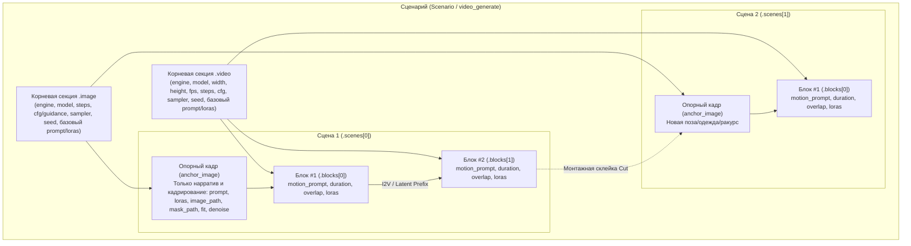

# Сценарный видеопайплайн и композиция (Scenario Design & Chaining)

Документ подробно описывает устройство сценарного конвейера `video_generate`, разделение глобальных технических параметров и локального нарратива, конкатенацию промптов, работу с базовыми шаблонами (`scenario_path`) и правила стыковки блоков.

---

## 1. Сценарная иерархия и модель данных

Сценарный генератор `media_mcp` ориентирован на создание целостных многосценных видеороликов с сохранением персонажа, окружения и кинематографического ритма.



---

## 2. Иерархия параметров и правила слияния

В `schemas/scenario.json` действует строгое разделение между технической конфигурацией движков и художественным описанием сцен/блоков:

1. **Технические параметры (строго в корневых `.image` и `.video`):**
   - В `.image`: `engine` (обязателен), `model` (обязателен), `steps`, `cfg`, `guidance`, `sampler`, `seed`.
   - В `.video`: `engine` (обязателен: `"wan-fast"`, `"wan-full"`, `"ltx"`), `model` (обязателен), `width`, `height`, `fps`, `max_duration`, `steps`, `cfg`, `sampler`, `seed`, `ramp_latents`, `min_cfg`, `weight_dtype`.
   - Размеры опорных кадров (`anchor_image`) автоматически наследуют `width` и `height` из `.video` для гарантированного совпадения пропорций.
2. **Нарративные параметры в `scenes[].anchor_image` и `scenes[].blocks[]`:**
   - В `anchor_image`: `prompt`, `negative_prompt`, `loras`, `image_path`, `keyframe_path`, `mask_path`, `fit`, `denoise`.
   - В `blocks[]`: `name`, `duration`, `overlap`, `motion_prompt`, `negative_prompt`, `loras`.
3. **Порядок конкатенации промптов (`combine_prompts`):**
   - Локальный промпт сцены или блока ставится **в начало**, а глобальный базовый промпт из `.image.prompt` / `.video.prompt` — **в конец** через перенос строки (`\n`):
     $$\text{Final Prompt} = \text{local\_prompt} + \text{"\textbackslash n"} + \text{global\_prompt}$$
   - **Обоснование:** Токены в начале промпта получают наибольший вес внимания в CLIP/T5, что позволяет усилить специфику конкретного кадра или движения блока, сохраняя глобальный стиль и описание персонажа в качестве контекстного базиса.
4. **Списки LoRA (`loras`):**
   - Глобальный список `loras` из `.image` / `.video` объединяется с локальным списком сцены или блока (`merge_lora_lists`). Если одна и та же LoRA указана и глобально, и локально, применяется `strength` из локальной секции.

---

## 3. Переиспользование базовых шаблонов (`scenario_path`)

Сценарии могут наследоваться от базовых файлов-шаблонов на диске:

```json
{
  "scenario_path": "examples/scenario.json",
  "scenes": [
    {
      "name": "Scene 1: Viewport Inspection",
      "anchor_image": {
        "prompt": "Hermione looking through reinforced train window into misty mountains"
      },
      "blocks": [
        {
          "duration": 5.0,
          "overlap": 0.0,
          "motion_prompt": "Slow tracking shot from behind, soft reflection on the window glass"
        }
      ]
    }
  ]
}
```

### Жизненный цикл `scenario_path`:
1. Функция `resolve_scenario_dict` считывает базовый JSON-файл по пути `scenario_path`.
2. Выполняет глубокий мердж словарей `.image` и `.video`, а при наличии `scenes` в запросе — атомарно заменяет список сцен.
3. Ключ `scenario_path` удаляется из словаря, а вычисленные случайные сиды записываются в `.image.seed` и `.video.seed` в `workflows/{run_prefix}-spec.json`.
4. Сохранённый файл `{run_prefix}-spec.json` остаётся на 100% валидным относительно `schemas/scenario.json` и может быть передан напрямую в повторный запуск `video_generate`.

---

## 4. Стыковка блоков: 1-кадровый I2V против 5D Латентного префикса

Пайплайн поддерживает два режима преемственности между блоками внутри сцены:

### Режим А. 1-кадровый I2V чейнинг (`overlap = 0.0s`, Продакшн-режим по умолчанию)
- **Принцип:** Блок $N$ генерирует свою последовательность кадров. Последний кадр $T-1$ извлекается нодой `SaveImage` в ComfyUI напрямую из несжатого float32 RGB тензора VAE и сохраняется как `temp/{run_prefix}-s001-b00N-tail.png`.
- Следующий блок $N+1$ инициализируется с этого кадра через `WanImageToVideo` (или `LTXVImgToVideoInplace`).
- **Дедупликация стыковочного кадра:** Кадр 0 нового блока совпадает с последним кадром предыдущего блока. Пайплайн автоматически нарезает рабочий клип ядра со сдвигом на 1 кадр (`batch_index = 1`), исключая эффект микро-фриза при сборке.

### Режим Б. True Forced 5D Latent Prefix (`overlap > 0.0s`)
- **Принцип:** Хвост латентов предыдущего блока (`temp/{run_prefix}-s001-b00N-tail.latent`) отрезается через `LatentCut` и передаётся в следующий блок напрямую в 5D латентном пространстве через ноды `WanLatentPrefixLock` (с Temporal CFG Ramp-Up) и `WanLatentPrefixRestore` — как для `wan-fast` / `wan-full`, так и для `ltx`.
- **Преимущество:** Полное отсутствие промежуточного декодирования/кодирования префикса через VAE (`VAEDecode` $\to$ `VAEEncode`), сохранение фазы движения и точное чтение числа временных кадров из заголовка `.safetensors` без загрузки `torch`.
